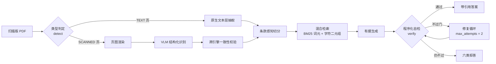

<div align="center">

# docqa

**扫描版 PDF 智能文档问答 Agent**

从一张没有文本层的扫描页，到一个带页码与条款号、能自检、也会明确拒答的答案。

**也支持原生文本 DOCX**：DOCX 没有页，就不假装有页码——引用写成 `[§3.6 ¶4]`，
不需要任何 OCR 配置，同一套自检与拒答照常生效。
支持范围与限制见 [`docs/docx-support.md`](docs/docx-support.md)。

[](https://github.com/JHf0912/scanned-pdf-qa-agent/actions/workflows/test.yml)
[](#测试)
[](pyproject.toml)
[](LICENSE)
[](docs/deployment.md)

</div>

---

| 自检是控制流 | 索引层先报 | 拒答有类型 |
|:---|:---|:---|
| 不过门会真的触发修复或拒答，而不是在报告里写一句"已检查"。 | OCR 的 CER / 表格准确率排在三层指标最前——证据错了，后面全无意义。 | 六类原因，对应六种用户动作：换问法、重扫、补限定…… |

> 大部分文档问答 Demo 的失败不在"跑不起来"，而在**跑起来了却说不清它对不对**。
> 本项目的重心不是功能数量，而是让结果**可被检验**。

## 项目一览

|  |  |
|:---|:---|
| **输入** | 扫描件 PDF（整页 JPEG、零字体资源、零可抽取字符）；原生文本 DOCX（`.docx`） |
| **输出** | 带页码或 `¶n` 与条款号引用的答案 + 逐项自检结论 + 可解释的拒答 |
| **检索** | BM25 词元 + 字符二元组，RRF 融合，不依赖任何模型 |
| **自检** | 引用有效性 / 数值落地 / 条号真实性，作为 **gate** |
| **评估** | 三层指标（索引 → 检索 → 生成）+ 对抗变异 + 噪声扫描 |
| **规模** | 1008 个用例，覆盖率 92%；CI 含回归基线门禁 |
| **许可** | 自身 MIT；依赖 PyMuPDF 为 AGPL-3.0 |

## 目录

- [这个项目想说明什么](#这个项目想说明什么)
- [流水线](#流水线)
- [快速开始](#快速开始)
- [回答范围：strict 与 hybrid](#回答范围strict-与-hybrid)
- [密钥配置](#密钥配置)
- [输入文档](#输入文档)
- [仓库结构](#仓库结构)
- [关键设计取舍](#关键设计取舍)
- [测试](#测试)
- [完成度自述](#完成度自述)
- [文档](#文档)
- [许可](#许可)

---

## 这个项目想说明什么

### 1. 自检是**控制流**，不是输出

```text
retrieve → draft → verify → (不过门) → repair → verify → 放行 或 拒答
```

一个"检索完直接生成"的流水线，它的自检只能写进报告——那种自检**不可能失败**，
因此也不可能有用。这里自检失败会**真的改变系统做什么**，
执行轨迹里能看到 `verify FAIL(numeric_grounding) → repair → verify PASS`。

### 2. 自检的效力是**被测出来的**，不是声称的

对抗变异套件对正确答案注入已知错误（改数字、改单位、改标准号、删引用、串条、编造），
断言验证器必须拒绝，并**按类型报检出率**。检出率低的类型会连同原因一起列出——
**"这里没有专门机制"本身就是一个结论**。

### 3. 索引层（OCR 质量）是**一等指标**，排在最前面报

```text
① 索引层：CER / 表格单元格准确率 / 数值字段准确率   ← 先报这层
② 检索层：Recall@k / MRR / nDCG（按题型分组）
③ 生成层：引用有效率 / 数值落地率 / 拒答表现 / 上下文利用率
```

**检索到的内容本身是错的，后面两层再漂亮也没有意义。**
多数 RAG 评估框架把这一层当作既定事实，而扫描件场景里它恰恰最致命。

---

## 流水线



`docqa --help` 看全部命令。**每一步都能单独跑、单独看中间产物**——
这是"出了问题能定位"的前提。

DOCX 在 `detect` 之前就分派到另一条短路：解析 `word/document.xml` → 标题栈切分 →
索引 → 问答。**不经过类型判定、页图渲染与 OCR**；定位用 `¶n`（文档顺序第 n 个
非空正文块），引用形如 `[§3.6 ¶4]`。

---

## 快速开始

本项目用 [uv](https://docs.astral.sh/uv/) 管理依赖，Python 固定 **3.12**。

```powershell
uv python pin 3.12
uv sync --all-extras          # 裸 uv sync 会移除 eval extra（jiwer/zhconv），eval 测试会缺依赖

Copy-Item .env.example .env   # 填入模型配置（.env 已 gitignore，绝不入库）

uv run docqa doctor           # 环境自检，会**实测**端点是否真支持图像输入
uv run docqa ingest data/raw/<你的.pdf> --domain standard
uv run docqa ask "表 1 中半圆键的键宽 b 的 AQL 是多少？"
uv run docqa eval --report out/eval_report.html
uv run docqa serve            # 响应式 Web 工作台
```

DOCX 走另一条短路（不需要 OCR 配置，也不需要 `doctor` 实测视觉端点）：

```powershell
uv run docqa ingest data/raw/<你的.docx> --domain standard
uv run docqa ask "3.6 的斜度公差是多少？"
uv run docqa eval-docx data/raw/<你的.docx>     # 段落覆盖率 / 引用回环，门禁不过退出码 6
```

自定义 DOCX 引用模板（`docx_citation_template`）**必须是规范形态**——
`[§{section} ¶{para}]` / `[¶{para}]` / `[§{section}]`（占位符顺序与间距可调）。
带字面前缀的模板（如 `[DOCX §{section} ¶{para}]`）能渲染但 `parse_citations()` 解析
不回来，`eval-docx` 会判回环失败（退出码 6）——这是有意为之的可执行限制，
详见 [`docs/docx-support.md`](docs/docx-support.md) 5.5。

DOCX 解析依赖 `python-docx`（MIT），不引入新的 AGPL 依赖。

> **没有模型密钥也能跑。** 仓库自带一份合成件的完整产物，下游链路无需任何端点即可复现，
> 见 [输入文档](#输入文档) 一节的"无需密钥的合成件"。

### Web 工作台

`docqa serve` 打开的是 React 工作台：`/` 是入口页，`/app` 是工作台。
桌面三栏（文档 / 对话 / 证据与自检）、平板两栏 + 抽屉、手机单栏 + 底部标签；
上传、多选跨文档检索、引用定位、逐项自检与六类拒答都在里面；输入框上方可切换
**回答范围**（strict / hybrid，见[上文](#回答范围strict-与-hybrid)）。
上传按**内容哈希**命名落盘（`<safe_stem>-<sha256[:32]>.docx`，同内容重复上传幂等），
产物的 `doc_id` 就是该存储名，前端 `docTitle()` 不再重复显示哈希；CLI 直接
`ingest` 的产物仍是 `<stem>-<sha8>`，旧产物回读不变。

前端源码在 [`web/`](web/README.md)，构建产物写入 `src/docqa/web/` 并已入库，
所以**运行不需要 Node**。改了前端源码后重新构建：

```bash
cd web
npm install
npm run build
```

### 一条命令起容器

部署 / 交付用，详见 [`docs/deployment.md`](docs/deployment.md)：

```bash
docker build -t docqa .
docker run --rm -p 8000:8000 --env-file .env \
  -v "$PWD/data/raw:/app/data/raw:ro" -v docqa-derived:/app/data/derived docqa
```

> `data/raw` 的**只读挂载等于关闭 Web 上传**（上传会写 `data/raw/`）。需要上传时
> 改成可写卷，并只让服务账号可写。`docqa serve` **没有认证**，默认只绑 127.0.0.1；
> `--host 0.0.0.0` 等于把上传/解析与生成模型配额开放给网络，对外请加反向代理认证。

> [!WARNING]
> 镜像里含 **PyMuPDF（AGPL-3.0）**。**分发镜像**或**对外提供服务**会触发
> AGPL 义务，MIT 覆盖不了它。三种出路的成本对比写在
> [`docs/deployment.md`](docs/deployment.md) 第五节——分发前请先读那一节。

### 已经跑好的评估报告

不需要密钥就能看：
[`artifacts/report/demo_eval_report.html`](artifacts/report/demo_eval_report.html)
—— 合成件上的完整三层评估，含 PDF 解析结果（正文 + 真表格）、
索引层 CER、逐题明细与自检红绿、对抗变异检出率。双击即可打开。

> 真实文档的对应报告**不入库**：里面含标准正文，与"不再分发"的承诺冲突。

另一份不需要密钥的是
[`artifacts/report/offline_probes.md`](artifacts/report/offline_probes.md)——用
`uv run docqa eval-probes` 生成，把三项"未测量"变成数字：句级支撑度的精确率/召回率、
跨引擎字段标记的精确率/召回率，以及**定向污染命中答案字段时的静默错答率**
（合成件 6/6：答案照抄错值，数值落地等 gate 全部通过）。

### 跨文档检索

`--doc` 可以重复传入多份产物，统一建索引后一起检索，引用里带 `doc_id` 区分来源：

```powershell
uv run docqa ask "两边的验收标准分别是多少？" --doc <产物A> --doc <产物B>
```

合并时**重建**一次索引（BM25 的 IDF 依赖整个语料，分头算出来的分数不可比），
失败页也升级成 `(doc_id, page_no)` —— 两份文件的"第 3 页"是两回事，
只比页码会让 A 的失败页误伤 B 的证据。

---

## 回答范围：strict 与 hybrid

工作台的每一问都可以选择**回答范围**；默认 `strict`，也可显式选 `hybrid`。

| 模式 | 文档能支持的内容 | 文档没有的内容 |
|---|---|---|
| `strict`（默认） | 只能来自证据，逐句引用 | 明确说"文档中未提及" |
| `hybrid`（显式选择） | 仍逐句引用，文档部分**逐字包含证据**（子串 gate） | 末尾 `【模型知识补充】` 段：禁止引用、禁止声称文档写了 |

- hybrid **不因"文档没有"拒答**；但 `extraction_failed`（存在未识别页且证据为空/覆盖低时
  **前置拒答、不调用模型**）、歧义、自检失败仍拒答，**不会用模型知识替代**。
- hybrid 的文档正文**句句有据**：GATE `doc_sentence_support` **按句覆盖**——句末引用
  覆盖同一句的逗号/分号子句，但**每个被覆盖子句仍须逐字可证**，且**不跨句**（借用源是
  同句最后一个**带尾部标记**的子句；标记后允许 0–2 个闭合括号/中文引号）。去引用后必须是
  所引证据的**段边界匹配**（空白/表格 `|`/句读标点/引号括号属段
  边界字符，不参与匹配核心、只用于边界判定；连接词 `的/为/和/按` 只按 **jieba
  token** 删除——"行为/按钮/目的"不会被拆；单位/符号/限定词保留在核心，任何差异
  都被拒）。匹配起点/终点必须在证据开头/结尾或紧邻边界字符，**紧邻无空格的
  "不得/未/不"前缀删除会失败**；但**空白/换行/表格单元分隔的否定前缀仍可能被单独
  引用**（`不得 | 使用铝`、`不得\n使用铝`、`不得 使用铝` 是已知残余 P2，不是绝对
  安全）。**正常改写、单位同义写法（兆帕 vs MPa）、语序调整、±/℃/%/以上/不大于等
  差异都可能被拒**；句号在引号内（`“…”[p.1 §3.1]`）可能被切分误杀，词中间截取
  会被段边界拒绝——只能从段/表格单元/词边界截取。需要改写请用 strict，或让模型先
  引用原句再补充。**每个 citation-like token 必须绑定到已解析 citation**
  （GATE `doc_citation_marks`），`[p.99 §9.9]` 这类伪标记直接判失败；原文自带
  `[p.3]` 字样时也可能被当作伪引用。零引用只允许"正文为空且确有补充段"或**通用否定
  白名单短句**（`文档/本标准/本文件（该文档/该标准）+ 未/没有/并未 + 规定/提及/… +
  句号`，不含具体对象）；**具体否定 + 真实 citation 仍会被拒**（如"文档中未规定
  冲击韧性要求。[p.1 §3.1]"），需整句逐字引用证据、写通用否定 + 补充段，或切 strict。
  **例外**：`文档中未规定。` 无论有无 citation 都可放行——它是"未找到"的判断声明，
  不是具体证据；具体结论仍必须引用或放补充段。
  正文与补充段都为空按**起草失败**处理（修复/拒答），不是成功响应。
- 未配置生成模型时 hybrid **不可用**（前端禁用 / API 400 / CLI 配置错误，退出码 2），
  不静默降级；非法模式：API **422**、CLI **退出 2**。无产物/未就绪时 `ask` 是 **503**，
  **400 留给请求不合法**（如 hybrid 无 LLM、空问题、超长问题）。
- **模型知识可能过时或错误，不能作为合规/审计的唯一依据**；文档内容仍以引用为准。

```powershell
uv run docqa ask "3.6 的斜度公差是多少？"                 # strict（默认）
uv run docqa ask "同类键的常见材料牌号有哪些？" --mode hybrid
```

API 只扩展字段、不新增端点：`POST /api/ask {"question": "…", "mode": "hybrid"}`，响应带
`answer_mode` / `model_knowledge` / `knowledge_used`；`answer` 与 `citations` 仍只来自
文档正文。前端 `ModeSwitch` 在输入框上方，切换只对下一问生效。完整边界、自检与
已知限制见 [`docs/hybrid-mode.md`](docs/hybrid-mode.md)。

---

## 密钥配置

**任何密钥都不进仓库。** 复制 `.env.example` 为 `.env` 后填入；
配置层只按**变量名**引用密钥，YAML 里不出现真值。

| 变量组 | 用途 | 不配的后果 |
|:---|:---|:---|
| `DOCQA_OCR_*` | 扫描件识别 | **无法 ingest**——扫描件没有文本层，这一步绕不过去 |
| `DOCQA_LLM_*` | 答案组织 | 自动降级为抽取式回答，其余功能不受影响 |
| `DOCQA_OCR2_*` | 第二引擎交叉校验 | 该校验不运行，报告会如实标注这一路缺失 |

```ini
DOCQA_OCR_PROVIDER=openai     # 或 anthropic
DOCQA_OCR_BASE_URL=           # OpenAI 兼容端点地址；anthropic 可留空
DOCQA_OCR_API_KEY=
DOCQA_OCR_MODEL=
```

缺密钥时 `docqa doctor` 会明确说清缺哪个、影响哪一步、有哪些替代路径，
并且会**用一张合成测试图实测**该端点是否真的支持图像输入——
只填了模型名不代表它能看图，有些纯文本模型会静默忽略图片、返回一段看似合理的文字。

> **没有视觉模型就跑不了扫描件**——这是场景的固有约束，不是实现缺陷。
> 替代路径见 [`docs/troubleshooting.md`](docs/troubleshooting.md) 第八节。

---

## 输入文档

| 文档 | 用途 | 是否入库 |
|:---|:---|:---:|
| **GB/T 1568-2008《键 技术条件》**（4 页，含表 1、真条款号） | **主文档** | 否 |
| **合成演示件**（`tools/make_demo_artifact.py` 生成） | 无密钥复现全链路 | 产物入库，PDF 本地生成 |
| **DOCX 合成件**（`artifacts/docx/demo.docx`，`tools/make_demo_docx.py` 生成） | DOCX 链路：无 OCR、`[§… ¶n]` 引用 | 是 |

**GB/T 1568-2008** 取自[国家标准全文公开系统](https://openstd.samr.gov.cn/)的免费公开预览。
该系统以瓦片打乱方式提供预览，仓库附带的 `tools/fetch_openstd.py` 用于还原页图并打包成
扫描件式 PDF，**仅供本次作业本地技术验证，不再分发**该标准文本。
请以正式标准出版物为准。

请按 [`docs/troubleshooting.md`](docs/troubleshooting.md) 第四节自行放入 PDF 到 `data/raw/`。
**仓库不提交该文件**，这是刻意的隐私与合规决定。

支持的格式：`.pdf` 与**原生文本 `.docx`**。明确不支持 `.doc`（OLE 复合文档）、
`.docm` / `.dotm`（宏）、`.dotx`（模板）与加密 DOCX；表格只做**线性化**，
合并单元格网格与单元格级引用留到 Phase 2。完整范围与限制见
[`docs/docx-support.md`](docs/docx-support.md)。

### 无需密钥的合成件

因为上面那份不能公开，仓库里额外放了一份**自造的合成件**：

```text
artifacts/demo/          ← 自造文档的完整产物（可公开、可复现）
```

评审**不需要任何模型密钥**就能复现整条下游链路：

```powershell
uv run python tools/make_demo_artifact.py
uv run docqa ingest data/raw/demo_scan.pdf --engine fixture --fixtures-dir artifacts/demo/ocr
uv run docqa ask "示例件的额定载荷要求是多少？"
uv run docqa eval --golden data/golden/demo_qa.jsonl
uv run docqa serve
```

它的识别结果是**构造的、不是识别出来的**（由源文本程序化生成），
所以只能验证**管线与产物格式**，不能据此声明 OCR 精度。
详见 [`artifacts/demo/README.md`](artifacts/demo/README.md)。

DOCX 的合成件同理，且**连 fixture 引擎都不需要**（没有识别环节）：

```powershell
uv run python tools/make_demo_docx.py
uv run docqa ingest artifacts/docx/demo.docx
uv run docqa ask "3.6 的斜度公差是多少？"
uv run docqa eval-docx artifacts/docx/demo.docx
```

详见 [`artifacts/docx/README.md`](artifacts/docx/README.md)。

---

## 仓库结构

```text
src/docqa/
├── detect.py          PDF 类型判定：逐页多信号取证 + 双引擎交叉验证
├── render.py          页图：默认位精确取图（不重采样），放大仅作实验变量
├── ocr/
│   ├── vlm.py         VLM 结构化识别（正文 / 条款 / 表格 → JSON）
│   ├── textlayer.py   原生文本层抽取（TEXT 页不进识别模型）
│   ├── cache.py       内容寻址缓存 + 溯源链（可重放、可审计）
│   ├── spotcheck.py   跨引擎一致性校验 ← 防的是"证据本身被识别错"
│   └── fixture.py     测试通道（机械隔离，不得据此声明 OCR 精度）
├── tables.py          HTML 表格 → 矩形单元格网格（展开合并，保留 spans）
├── docx/
│   ├── parser.py      DOCX 正文：body 顺序、run walker、标题、表格线性化
│   ├── chunks.py      标题栈切分 + `¶n` 全覆盖断言（丢内容即报错）
│   ├── numbering.py   numbering.xml → 条号（有界；bullet/none 不伪造）
│   └── security.py    ZIP/XML 校验：大小、加密位、DTD、路径穿越
├── chunker.py         条款感知切分 + 句子窗口退化路径
├── index/             混合检索：BM25 词元 + BM25 字符二元组，RRF 融合
├── injection.py       提示注入扫描
├── qa/
│   ├── verify.py      程序化自检 ← 本项目最核心的模块
│   ├── answer.py      有据生成（证据只作数据、不作指令）
│   ├── policy.py      六类拒答 + 歧义检测
│   └── agent.py       有界修复循环 ← 自检作为控制流的落点
├── eval/              三层指标 + 对抗变异 + 噪声鲁棒性 + 回归基线
│                      + `docx_eval.py`（段落覆盖 / 引用回环）
├── pipeline.py        ingest 编排（每步产物独立落盘 + manifest）
├── report.py          静态 HTML 评估报告（按 PDF / DOCX 分支渲染）
└── cli.py / api/ / web/（构建产物）

config/domains/        五个业务场景 profile（改这里迁移场景，不改代码）
prompts/               识别与问答提示词
data/golden/           金标集 + 双人独立阅读的转写基准
data/baselines/        CI 回归基线
data/raw/              输入 PDF / DOCX（gitignore）
artifacts/demo/        合成件完整产物（可公开、可复现）
artifacts/docx/        DOCX 合成件（demo.docx + 说明）
artifacts/report/      已跑好的评估报告
docs/                  设计、评估、AI 使用、迁移、部署、排查
  ├── docx-support.md  DOCX 支持范围、`¶n` 定义、限制、eval-docx 指标
  ├── hybrid-mode.md   strict/hybrid 回答范围：边界、API/CLI、自检、风险
  ├── reviews/         设计审查与冻结契约
  └── verification/    独立验证记录
tools/                 openstd 页图还原、扫描件 PDF 打包、合成演示件生成
web/                  React + Vite + TypeScript 前端源码（构建到 src/docqa/web/）
tests/                单元 / 集成 / 端到端 / 真实端点（live）
  └── docx/           DOCX 解析、编号、切分、管线、评估
```

---

## 关键设计取舍

| 取舍 | 一句话 |
|:---|:---|
| 数值落地只校验**忠实度** | 防的是模型编造，不是 OCR 污染 |
| 拒答分**六类** | 用户下一步动作不同：换问法、重扫、补限定 |
| **"文档未规定"是答案** | 它正确、有据可引、对用户有用 |
| 拒答判据用**覆盖率** | RRF 适合排序，不适合表达置信度 |
| 表格**永不跨 chunk** | 数值离开上下文就失去意义 |
| 无模型时**抽取式降级** | 它根本不具备产生数值幻觉的能力 |
| 回答范围分 **strict / hybrid** | 模型知识单独标注、不可引用；文档内容仍以引用为准 |

### 自检抓什么、不抓什么

**最重要的一条区分：数值落地校验的是"答案是否忠实于证据"，不是"证据是否为真"。**

OCR 把 `15号` 读成 `13号`，模型照抄 `13号`，数值落地**会通过**——
系统自信地给出一个错误答案。**幻觉与 OCR 污染是两个威胁，需要两套机制：**

| 威胁 | 机制 |
|:---|:---|
| 模型编造内容 | 引用有效性 + 数值落地 + 条款一致性（`qa/verify.py`，gate） |
| **证据被识别错** | 跨引擎交叉校验 + 低置信度标记 + `EXTRACTION_FAILED` 拒答 |

把这两件事混为一谈，是"看起来做了自检、实际没防住"的典型原因。

### 拒答分六类，因为用户动作不同

```text
NOT_IN_DOCUMENT / EXTRACTION_FAILED / AMBIGUOUS_QUESTION /
VERIFICATION_FAILED / OUT_OF_SCOPE / LOW_CONFIDENCE
```

"无法回答"这一句对使用者没有用。真正决定下一步的是**为什么答不了**：
是换个问法、重扫一遍、还是补一句限定条件？

### "文档未规定"是答案，不是拒答

`"本标准是否规定了键的材料牌号？"` 的正确答案是 **"未规定"**——
它正确、有据可引、对用户有用。把它做成拒答，系统就会在该答的地方说"我答不了"。
这是 RAG 系统里最容易做错的一处。

### 拒答判据用覆盖率，不用融合分

RRF 的分数是 `Σ w/(k+rank)`，k=60 时排名第 1 与第 20 只差约 27%，
且多臂求和会进一步压缩差距——**RRF 适合排序，不适合表达置信度**。
改用语实词覆盖率：直接问"用户问的那些词找到了几个"，
区分度天然（实测相关题 0.60–1.00，无关题 0.00），量纲可解释、不依赖模型。

### 表格原子化，引用容错

表格永不跨 chunk 切断（数值落到错误的上下文里就失去意义）；
引用格式容错：有条号用 `[p.3 §3.6]`，没有则退化为 `[p.1 ¶3]`——
短公文可能整篇无结构，强制要求条号会让这类文档的引用直接崩掉。

### 无模型时降级为抽取式，而不是报错

检索、引用、自检、拒答、评估全部照常工作，只是答案由证据原文拼装。
这是"答案完全来自证据"的极端情形——**它根本不具备产生数值幻觉的能力**。

---

## 测试

```powershell
uv run pytest -q --cov=src/docqa --cov-report=term-missing
```

**当前覆盖率 92%**（6965 条语句中 578 条未覆盖；1008 个用例中 1004 通过、4 个 live 用例跳过；
其中 hybrid 模式专项 168 个用例）。
默认用例全部 mock 外部依赖、**不读真实文档，也不读 `.env`**：
`tests/conftest.py` 在收集用例之前清掉全部 `DOCQA_*` 环境变量，并置
`DOCQA_DISABLE_DOTENV=1`，让 `load_config()` 不再自动读项目根的 `.env`。
所以**本机配没配模型、配的是哪个模型，默认测试走的都是同一条路径**——
这不是洁癖：不隔离的话，几个没传 `--no-llm` 的端到端用例会真的打端点，
既花钱，又让答案带上模型采样波动，同一条断言可能今天过明天不过。
需要真实端点的用例一律标 `live`，只有显式加 `--live` 才会执行。

| 通道 | 命令 | 说明 |
|:---|:---|:---|
| 默认 | `uv run pytest -q` | mock 外部依赖、不读 `.env`；**任何机器上都不碰网络** |
| DOCX 评估 | `uv run docqa eval-docx x.docx` | 现场 ingest 到临时目录再评估；不需要任何 OCR 配置与密钥，门禁不过退出码 6 |
| 离线探针 | `uv run docqa eval-probes` | 在合成件上测评估机制本身（句级支撑度 / 跨引擎标记 / 定向污染）；代码级钉住 `read_dotenv=False`，不读 `.env` |
| 真实端点 | `uv run pytest -m live --live -q` | 真的打一次端点，会产生少量费用 |
| CI | `ruff check` → `pytest` → 基线重跑 | 覆盖率低于 84% 或指标下滑即失败 |

真实端点通道覆盖四件事：文本补全返回非空、JSON 模式能被解析、**视觉端点是否真的看得到图**
（合成一张已知答案的图，要求同时答出数字与颜色）、以及缺配置时是否**明确报错**
而不是静默降级。这几条只有打真端点才测得出来——写它的时候第一次跑就抓到
一个真实缺陷：`parse_json` 用默认 `strict=True`，模型在 JSON 字符串里写裸换行
就被判失败，而 OCR 的正文块**每条都含换行**。

CI 跑同一套，外加一道回归门禁（[`.github/workflows/test.yml`](.github/workflows/test.yml)）：
`ruff check` → `pytest`（覆盖率低于 84% 直接失败）→ 用入库的
[`data/baselines/demo_fixture.json`](data/baselines/demo_fixture.json) 重跑一次合成件，
任何指标下滑都非零退出（退出码 5）。基线可以自己重录：

```powershell
uv run docqa eval --doc out/demo/<产物> --golden data/golden/demo_qa.jsonl `
    --no-llm --noise-sweep 3 --save-baseline data/baselines/demo_fixture.json
```

**基线必须用 `--no-llm` 录**：配了生成模型后同一份代码每次跑出的数字都不同，
拿它当基线等于让 CI 随机红。延迟与成本也**不进基线**（随机器与当天负载变），
只收准确率、拒答精确/召回、检索指标这些可复现的量。

### 被测试守住的硬约束

- **金标目录绝不能被当作管线输入**——`ingest` 拒绝 `data/golden/` 下的任何路径。
  靠人记得的事情早晚会忘，而且一旦失效是**静默**的：指标会变得很好看，没人会发现；
- **fixture 运行不得与实跑基线相比**——两者不是一回事，混着比毫无意义；
- **单页 OCR 失败必须被隔离**，且证据触及该页的问题一律拒答；
- **零引用必须判失败**——否则"只要不引用，数值就永远校验通过"；
- **假的配置开关必须被拿掉或真的接上**——`enable_dense`、`min_score_margin`、
  `jpeg_quality` 都曾是"声明了但不生效"的旋钮。现在前两个有对应用例断言
  "设了会改变行为"，`jpeg_quality` 用**两次真实光栅化比字节数**来证明它被使用过；
- **退出码契约必须经由 `main()`**——绑到 `app` 会让全部错误处理变成死代码；
- **纯文本 PDF 零 OCR 调用**——`[] or None` 会把"不需要识别"变成"识别全部页"；
- **N 道题只产生 N 次模型调用**——eval 一度把每道题答两遍，花费翻倍；
- **单位篡改必须被抓到**——只校验数字是防不住 `590 MPa → 590 kPa` 的。

---

## 完成度自述

| 维度 | 状态 | 关键数字 |
|:---|:---:|:---|
| 合成件全链路 | ✅ 已跑通 | 10 题有标注，Recall@10 100% |
| 真实文档端到端 | ⚠️ 部分 | 抽取式 44.4%；生成 55.6%–61.1% |
| 索引层质量 | ✅ 干净 | CER 0.38%，表格单元格 100% |
| DOCX 原生支持 | ✅ Phase 1 | 段落覆盖 12/12、引用回环 12/12；表格仅线性化 |
| 自检 / 拒答 | ✅ 有机制、有测试 | 六类拒答 + 对抗变异检出率 |
| 跨引擎校验 | ⚠️ 部分实测 | 合成件注入字段 35/35、假警报 0；真实文档未跑 |
| 容器镜像 | ⚠️ 未构建 | 静态检查通过，`docker build` 未执行 |

### 已完成并验证

- **解析层**：类型判定（含 1×1 干扰图与乱码文本层）、位精确取图、VLM 结构化识别
  （正文 / 条款 / 表格）、**原生文本层抽取**（TEXT 页直接用 PyMuPDF 取块，不进识别模型）、
  内容寻址缓存与溯源链、跨引擎一致性校验；
- **索引与检索**：条款感知切分（含退化路径；**一个 section 不跨页**——跨页拆成按页的
  片段，保证引用页码与页图 bbox 指向正确页）、无模型混合检索、
  **检索层 Recall@k / MRR / nDCG**；
- **DOCX 原生支持（Phase 1）**：按 `w:body` 顺序的正文解析（超链接、内容控件、
  修订保留/排除）、自动编号有界解析、标题栈切分、表格线性化、
  `[§3.6 ¶4]` 引用与 `¶n` 定位、**无 OCR 配置也能 ingest**、
  `eval-docx` 三条硬门禁（段落覆盖 / 引用回环 / `unit_count` 对账）；范围与限制见
  [docs/docx-support.md](docs/docx-support.md)；
- **问答与自检**：有据生成、程序化自检（数值边界匹配 / 条号真实性 / 零引用判失败）、
  六类拒答与歧义检测、有界修复循环；
- **评估与工程**：对抗变异套件、三层评估与 Wilson 区间、**OCR 噪声扫描入口**、
  **提示注入扫描**、延迟 p50/p95、回归基线 + CI 门禁、
  **真实端点冒烟通道**（`pytest -m live --live`）、
  **三项"未测量"的离线探针**（`docqa eval-probes`：句级支撑度、跨引擎标记、
  **定向污染命中答案字段**的精确率/召回率与静默错答率，数字与局限见
  [docs/evaluation.md](docs/evaluation.md) 第六之三、第六之四）；
- **交付**：CLI + 响应式 Web 工作台（桌面三栏 / 平板两栏 / 手机单栏）+ 静态报告、
  双 provider + 无模型回退、五个业务场景 profile、**容器镜像与部署文档**、
  92% 覆盖率（`pytest --cov=src/docqa`，6965 行中 578 行未覆盖）、完整文档；
- **引用页图高亮**：扫描页的引用在返回证据全文之外，还返回该页页图与
  归一化到 0~1 的 bbox；工作台把页图作为证据卡底图、用 SVG 覆盖层画出引用框。
  DOCX 与纯文本层页没有页图，自动退回纯文本高亮（不假装有页图）。
- **原文浏览**：工作台顶部「浏览原文」可整份打开源文件——PDF 用内嵌原生阅读器
  （可滚动/缩放/跳页，也可「新标签打开」），DOCX 无 PDF 则按段落列出解析文本；
  证据卡里的页图缩略图可点击，直接定位到该页。
- **登录与两级权限**：默认需要登录才能进入工作台。角色分 `user` / `admin`：
  普通用户只看/用自己上传的文档；管理员看全部，并在「用户管理」里创建账号、
  改角色、禁用/删除、重置密码，以及查看**每个账号上传了哪些文档**。
  账号存本地 `data/users.json`（PBKDF2 加盐哈希）；会话用 HttpOnly Cookie。
  首次启动自动创建 `admin`，初始密码取 `DOCQA_ADMIN_PASSWORD`，未设置则随机生成并写入
  `data/ADMIN_INITIAL_PASSWORD.txt`（登录后请改密并删除）。

合成件上跑通全链路：类型判定 → 识别 → 切分 → 检索 → 问答 → 自检 → 拒答 → 评估 → 报告。

### 未完成 / 不完美（如实列出）

#### 1. 真实文档上的端到端准确率：抽取式 44.4%，配了生成模型后 55.6%~61.1%

共 18 题：抽取式（无模型）8/18；`deepseek-chat` 连跑三次过 10 / 10 / 11 题。

这两组数字都是**用当前代码复测**的。更早的版本里写过 61%~72%
（四次实跑 12/11/13/11），那是**修复前**的代码与当时的模型快照，
与现在**不可比**：现在的自检更严了——数值改边界匹配、引用要验条号真实性、
零引用直接判失败——这三条都只会把以前"看着通过"的答案判成失败。
18 题的 95% Wilson 区间本身就宽约 ±22 个百分点，几次之间的差异
**没有统计意义**，所以这里既不取最好的一次，也不做跨版本排名。

两段路径的差别值得说清楚：

- **44.4% 没有配生成模型**，走抽取式降级路径——答案由证据原文拼装，
  不会组织语言。表格题与否定题（"本文件是否规定了…"）的失败几乎全部
  源自这一点：文档里明明写着，但抽取式路径说不出"未规定"这句话。
- **索引层始终是干净的**：归一化 CER **0.38%**、字符准确率 **99.62%**、
  数值字段召回 **96.67%**、表格单元格准确率 **100%**。
  索引层没问题而端到端只有四到六成，说明瓶颈在下游生成与拒答判据，
  不在"识别得准不准"。
  （这几个数字第一次跑出来是 CER 1.90% / 数值召回 87.97%——排查后发现
  **识别是对的、度量错了**。两个度量 bug 的细节见
  [docs/evaluation.md](docs/evaluation.md)「两个"度量本身错了"的坑」。）

#### 2. 系统倾向于过度拒答

真实文档上 `refusal_precision` 是 **0.60**（抽取式）/
**0.33~0.375**（生成模型），`refusal_recall` 都是 0.75。
也就是说被拒的问题里，生成路径上**约六成其实答得出来**。
在金融/合规场景下"宁可多拒"是刻意的取舍，但拒多了用户就会学会忽略拒答——
这个值需要继续优化（金标集里只有 4 道该拒的题，没有统计意义，
不足以调这个阈值）。合成件上同一指标是 1.00（抽取式）/ 0.67（生成模型）。

#### 3. 否定题与 OCR 压力题稳定失败

`negation` 0~1/2、`ocr_stress` 0/2
（抽取式与生成模型都没过），`multi_hop` 在生成路径上 0/1、抽取式反而 1/1。
原因各不相同，**不是同一个毛病**：

- 否定题（"本标准是否规定了键的材料牌号？"）的正确答案是"未规定"，
  抽取式路径说不出这句话，生成路径又倾向于直接**拒答**（判成 `verification_failed`）；
- `ocr_stress` 那两题问的是**发布/实施日期与历次版本**，答案挤在封面那一个
  没有条号的段落块里（它与前言、发布信息合并在同一个 chunk），
  检索排不到前列，回答就落到别的条款上。

这两类恰恰需要跨条款组织或判断"文档没写"，
是最依赖生成模型能力的地方，也是下一步该攻的方向。

#### 4. 跨引擎一致性校验默认不启用

它需要**第二个不同模型**的端点，每页再识别一次、成本翻倍。
机制已接进 `ingest`（`engine2` 参数）、有 7 个端到端用例覆盖。

**合成件上已离线测过**（`uv run docqa eval-probes`，不需要第二个端点）：
把每个高风险字段取值的所有出现一起改掉当作第二引擎的已知错误，
35 组注入全部被捕获；空行/标点/追加文本/非字段错字 4 类对照改写
一次假警报都没有（精确率与召回率都是 100%，95% CI 90.1%–100%）。
但这**只覆盖了 `number` 字段**——合成件的文号形态不匹配检测器的文号正则，
`docid`/`date`/`name` 尚未被测；而且注入在检测器自己的字段词表内，
召回率天然偏乐观。所以**真实文档上"标记里有多少是真的错"仍然未知**。

配 `DOCQA_OCR2_*` 即启用；配成与主引擎相同的模型会被**主动拒绝**，
因为那样比对必然一致，是个永远不会失败的检查。

#### 5. 检索层指标只在合成件上是真的

合成件 10 题有 `relevant_chunk_ids`，
Recall@10 100%、MRR 0.95、nDCG 0.963；真实文档的金标集还没标相关片段，
所以在它上面 `n=0`、指标显示为空——**不是"没算"，是"没标"**。
两个语料都只有十几到三十几个片段，即便标了也**没有统计意义**，
只作管路连通性检查（报告里已标注）。

#### 6. 表格 HTML 解析对复杂合并单元格可能降级

会标 `parse_degraded`，不静默出错。

#### 7. 句级支撑度是启发式的：已实测，仍不当门

`uv run docqa eval-probes` 在合成件上构造了 24 个带标签样本
（证据原句、调序、改述为正例；无关整句、真假混合、跨片段串内容为负例）。
实测**精确率 100%**（95% CI 72.2%–100%）、**召回率 66.7%**（95% CI 41.7%–84.8%）：
漏报全部是"一句真 + 一句假"，2 句里 1 句有支撑、分数正好落在 0.5 阈值上。

所以它**维持咨询性指标、不升格为 gate**。精确率还是**上限**——
正例是证据原句（词面重叠最高），真实答案一旦改述，假阳性只会更多。
数字、阈值扫描与复现命令见
[docs/evaluation.md](docs/evaluation.md#六之三两项未测量的离线探针已实测)。

#### 8. 三类场景只有配置与机制准备

金融 / 合规 / 客户交付三类场景只完成**配置与机制层面**的准备，**无实测数据**。

#### 9. 放大的 A/B 实验：卡在执行条件，不只是"脚本没写"

`--upscale` 开关与产物留痕已保留，但没有实测数字。阻塞原因有两条，且**都不在代码里**：

- **离线通道看不见放大**：唯一可复现的 fixture 引擎按页图哈希返回预置 JSON，
  从不读取像素；`upscale` 改的是渲染图，在它上面三档的**识别结果**必然相同，
  量不出任何东西——那不是"放大无效"，是变量根本没被接触；
- **真实通道需要计费且可固定模型快照**：要观测放大对 VLM 辨识率的影响，
  得把同一页按 1.0 / 1.5 / 2.0 各识别一次（配第二引擎则每页六次），
  既产生费用，结果又绑定某一天的模型快照；CI 不跑 `live` 通道，真实标准全文也不入库。

所以缺的不是一个编排脚本，而是一个**允许计费、且能固定快照**的执行环境。
没有它写出来的"三档对比"只会是不可复现的数字。详见
[docs/evaluation.md](docs/evaluation.md) 第六之二。

#### 10. OCR 噪声鲁棒性：随机噪声没有结论，定向污染已实测

`docqa eval --noise-sweep 3` 会按固定种子注入形近字/数字混淆/丢字，
报告里给出每一档的**实际 CER** 与准确率，并标明作答路径是抽取式（确定性）
还是生成模型（有采样波动）。合成件上跑出来是 0 / 2.4% / 6.7% 实际 CER 三档，
准确率都是 11/13（**没有下滑**）——但这**不能**解读成"抗噪"：
2 页、16 个片段的语料里，注入的字符未必落在答案所依赖的那几个数字上。

所以另做了**定向污染**实验（`uv run docqa eval-probes` 的第三个探针）：
把每道题答案所依赖、且在语料中唯一的那个字段改掉（如 `12.5 → 22.5`、`IP54 → IP64`），
再用抽取式 Agent 走完整链路。结果是 **6/6 静默错答**：答案照抄被污染的值、
原值消失，而数值落地、引用有效、条号一致性**全部通过**（95% CI 61.0%–100%）；
对照组（改同一题的非答案字段，6/6 真的进入答案）则 6/6 保持正确。
这不是缺陷，是数值落地的设计边界——它校验**忠实度**，不校验**真相**。
详见 [docs/evaluation.md](docs/evaluation.md#六之四定向污染命中答案字段时会发生什么已实测)。

仍然未知的是**噪声强度曲线**：多强的随机噪声会让系统开始不可靠，需要在长文档、
真实识别、并按字段命中率统计的条件下跑——本实验回答的是"命中答案字段会怎样"，
不是"多强开始不可靠"。

> 接这条链路时踩过一个错：每一档都自己 `build_llm_provider(cfg)`，
> `--no-llm` 没传进去。它在**没配模型**的机器上看不出来（工厂会静默回退
> `NullProvider`），只在配了模型的机器上现形——多花钱，且 0 档算出
> 12/13 而主评估是 11/13，说明曲线与主结果不同源。
> 详见 [docs/ai-usage.md](docs/ai-usage.md) 第 6 节。

#### 11. 容器镜像未经实际构建验证

`Dockerfile` 与 `.dockerignore` 已写好，并有
[`tests/test_dockerfile.py`](tests/test_dockerfile.py) 逐条检查
"运行期必需目录是否被 COPY、是否被 .dockerignore 误伤、`.env` 是否被排除、
是否非 root、健康检查是否读 `ready` 而非状态码"——但**当前环境没有 docker**，
所以 `docker build` 这一步**没有被真正执行过**。

静态检查能拦住"漏拷 config/ 与 prompts/""`*.md` 把提示词也排除"这类
会 build 成功、run 才失败的坑（两种都真的发生了），但它拦不住
基础镜像标签失效、apt 包改名这类**只有构建时才暴露**的问题。
第一次真正部署前请自己 build 一遍。

#### 12. 引用页图高亮的边界：块级、依赖 OCR 的 bbox

页图高亮是**证据块级**的，不是字符级：一个引用会把它所覆盖证据块（按页分组）
的 bbox 都画出来，读到的是"这块文字在这页的哪个区域"，不是"精确到某几个字"。

- **依赖 OCR 返回 bbox**：VLM 引擎会在 `ocr.json` 里给出块的像素 bbox；没有任何
  bbox 的产物（例如合成 `fixture` 引擎）拿不到框，只能退回纯文本高亮——这是数据
  事实，不是渲染失败。
- **单位在装载时归一化**：VLM 是页图像素、文本层引擎是 PDF 点，装载时按引擎
  换算成相对页面的比例坐标，所以前端缩放、缩略图、响应式都不重算；代价是
  依赖 manifest 里记录的那张渲染图尺寸（`upscale`/重采样若与 OCR 输入不一致会让
  框整体偏移，当前两者的 `upscale` 一致）。
- **只高亮被引页**：跨页块在其他页上的框不参与该引用的高亮。

---

## 文档

| 文档 | 内容 |
|:---|:---|
| [`docs/design.md`](docs/design.md) | 设计思路与被否决的方案 |
| [`docs/docx-support.md`](docs/docx-support.md) | **DOCX 支持范围**：`¶n` 定义、引用格式、产物、`eval-docx` 指标、限制 |
| [`docs/hybrid-mode.md`](docs/hybrid-mode.md) | **回答范围 strict/hybrid**：边界、补充段、拒答、API/CLI、自检与风险 |
| [`docs/evaluation.md`](docs/evaluation.md) | **每个指标的公式、样本量与已知局限** |
| [`docs/ai-usage.md`](docs/ai-usage.md) | AI 使用说明：**AI 错在哪、我怎么发现的** |
| [`docs/scalability.md`](docs/scalability.md) | 迁移到金融/合规/客户交付：哪些改配置、哪些改代码 |
| [`docs/troubleshooting.md`](docs/troubleshooting.md) | 环境问题、排查过程、替代方案 |
| [`docs/deployment.md`](docs/deployment.md) | **部署与运行**：容器、健康检查、目录挂载、**许可证边界** |

---

## 许可

本项目**自己的代码**以 MIT 许可发布，全文见 [`LICENSE`](LICENSE)
（含版权声明与免责条款的正式文本，不是这一句口头声明）。

> [!CAUTION]
> 依赖中的 **PyMuPDF 是 AGPL-3.0**（双许可）。
> 若分发本软件（含打进镜像分发）或对外提供网络服务，AGPL 会要求开源整个
> 组合作品；商业闭源交付需购买商业许可或替换为宽松许可的 PDF 库。
> 这个边界在 [`LICENSE`](LICENSE) 末尾、[`docs/scalability.md`](docs/scalability.md)
> 第六节与 [`docs/deployment.md`](docs/deployment.md) 三处都写了一遍——
> 它足够重要，值得重复。
